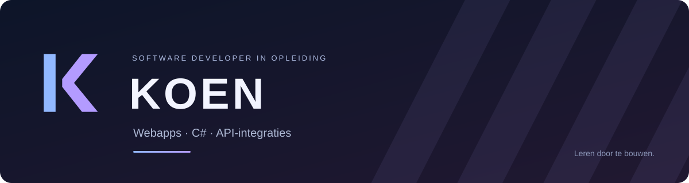

Ik ben Koen, software developer in opleiding in Someren. Ik werk aan webapps, Windows-software en projecten waarin verschillende systemen samenwerken. Ik leer door ideeën uit te werken, nieuwe technieken toe te passen en mijn projecten stap voor stap te verbeteren.

## Projecten

| Project | Wat het doet | Technieken |
| --- | --- | --- |
| **[Luma](https://luma-talen.vortex-cr.chatgpt.site/)** | Interactief leerplatform voor Duits, kunst en scheikunde, met eigen leerwerelden, oefeningen en voortgang. | React, TypeScript, Tailwind CSS |
| **Quizmester** | Windows-quiz met vier gamethema’s, Klassiek, Timermodus en Boss Battle, plus accounts en ranglijsten. | C#, Windows Forms, SQL Server |
| **DocFlow** | Bestanden uploaden en terugvinden, afbeeldingen automatisch verwerken en metadata exporteren naar PDF. | PHP, JSON, Dompdf |
| **Nexus** | Filmdashboard met zoeken, genrefilters en filmdetails, gevoed door een n8n-workflow en TMDB. | JavaScript, jQuery AJAX, n8n, REST API |
| **Game Score Manager** | Spelers, scores en een leaderboard beheren via een consoleapp en REST API. | Python, FastAPI, SQLAlchemy, SQLite |

Luma is online te bekijken. De andere genoemde toepassingen gebruik ik lokaal. Mijn vernieuwde portfolio is momenteel ook lokaal in ontwikkeling.

## Waar ik mee werk

- **Frontend:** HTML, CSS, JavaScript, React, TypeScript, Tailwind CSS en responsive interfaces.
- **Backend:** PHP, Python, FastAPI, authenticatie en inputvalidatie.
- **Databases:** MySQL, SQL Server, SQLite, SQLAlchemy en JSON-opslag.
- **Desktop & games:** C#, .NET, Windows Forms, gamelogica en UI-animaties.
- **Koppelingen:** REST API’s, webhooks, n8n, jQuery AJAX en Docker.
- **Tools & hardware:** Git, GitHub, VS Code, Visual Studio, Arduino en seriële communicatie.

Dit zijn technieken die in mijn projecten terugkomen en waarin ik me verder ontwikkel. Bij de uitwerking gebruik ik ook AI-ondersteuning.

## Mijn aanpak

Ik wil begrijpen wat een toepassing moet oplossen, dat vertalen naar een bruikbare interface en de onderdelen laten samenwerken. Daarbij werk ik aan code, gegevensopslag en foutafhandeling, en neem ik feedback mee in de volgende versie.

## Contact

[Stuur me een e-mail](mailto:90847@roc-teraa.nl) · [Bekijk Luma](https://luma-talen.vortex-cr.chatgpt.site/)